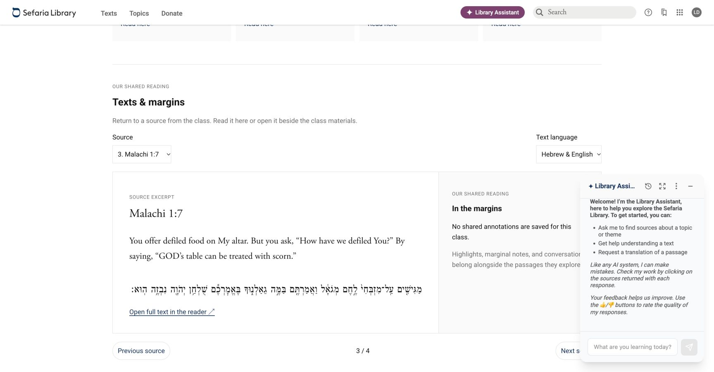
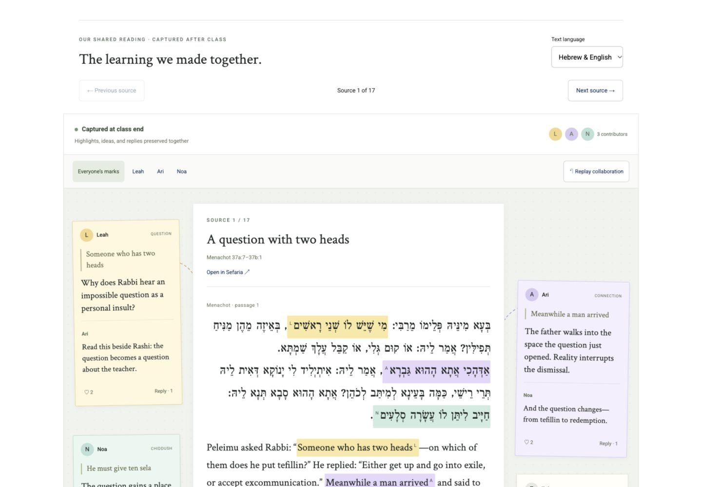

# After-class learning: feature and design reference

This review contains two deliverables: a working after-class page built on existing recording assets, and an interactive reference for the fuller learning experience.

## Review the working feature

After a host successfully stops and saves a recorded shiur, the existing `/social/rec/:recordingId` page brings together playback, the chronological text itinerary, a distinct-source bibliography, bilingual source excerpts and a searchable transcript when available. It links back to Social and the room.



Source texts render in a reading workspace. The margin pane is empty until stored annotations are supported. Summary, chiddushim, open questions and next learning have explicit empty states. This PR does not generate or save those assets.

## Review the full product direction

The [asset taxonomy](asset-taxonomy.md) explains every artifact, how it should appear, and the data needed to support it. The shared annotation artifact preserves the actual texts with participants’ ideas in the margins.



The interactive reference uses a Peleimu class with illustrative participants and discussion. Its populated annotations and synthesis describe the intended experience; they are sample content, separate from the working feature.

## Open the interactive reference

Download [interactive-reference.zip](interactive-reference.zip), unzip it, and open `class.html` in the extracted folder. For browser clipboard features, serve that folder locally:

```sh
cd after-class-reference
python3 -m http.server 3110
```

Then open <http://localhost:3110/class.html#annotations>. No database, account or application setup is needed. All local HTML, scripts, styles and the logo are included. Text links open the Sefaria reader.

## Test the feature

Use the repository’s normal reader + Social setup with this branch’s surface and server builds.

1. Sign in, create or enter a room as host, and begin recording.
2. Visit several text references, including returning to an earlier source.
3. Stop and save the recording. Confirm that the saved class page opens.
4. Confirm the itinerary preserves visits and the bibliography lists distinct sources; library navigation such as `texts` must not appear as a source.
5. Select sources, switch English/Hebrew/bilingual excerpts, and follow a full-reader link.
6. Seek playback from an itinerary timestamp. For a recording with a transcript, search it and seek from a matching passage.
7. Check processing, unavailable and failed transcript states without a transcription service or with the corresponding fixture.
8. Return to the room and Social; test a narrow screen and keyboard navigation.

The design reference is independent of these steps. Its sample content is not a production fixture.

## Review and follow-up

The new spec is [061](../../../specs/061-after-shiur-page/spec.md). A human code owner must approve it through the repository’s factory workflow before this feature can pass the merge gate. Review the working feature and taxonomy together, then scope stored annotations and synthesis as subsequent implementation work.
